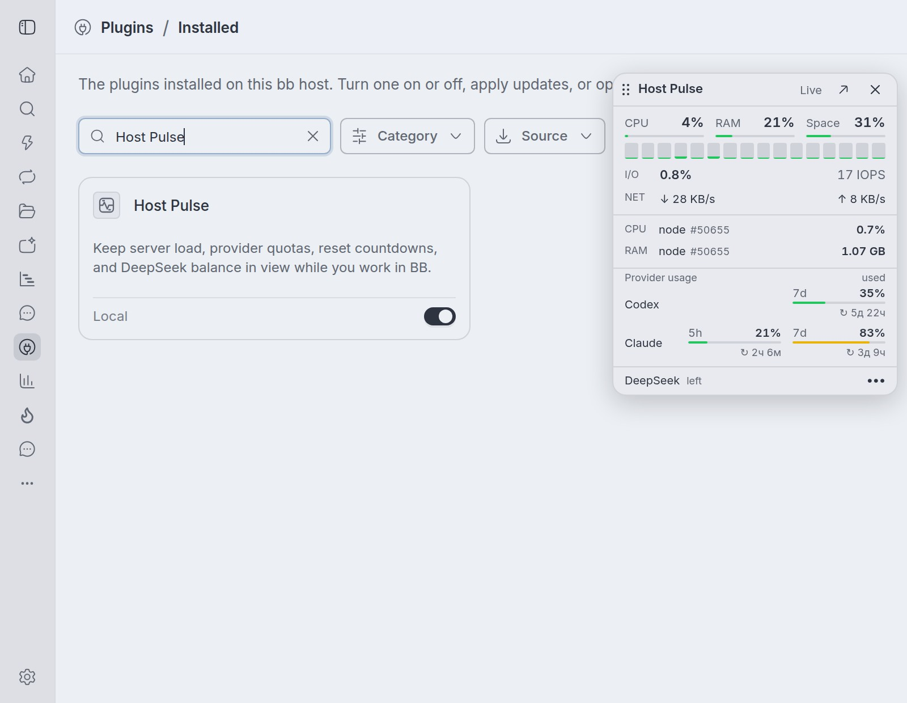
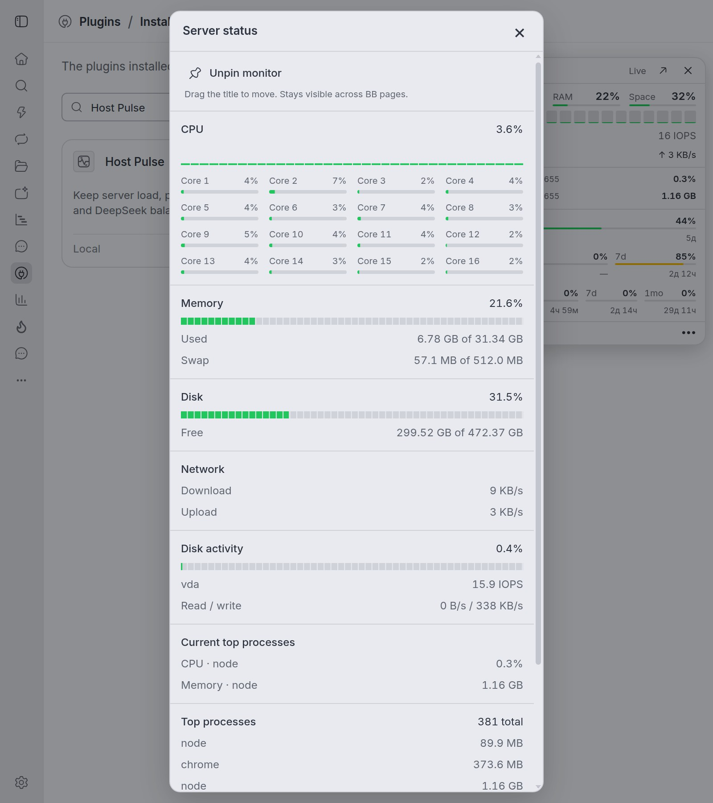

# Host Pulse

See CPU, memory, disk, and processes on the BB server in a draggable floating monitor.





The **Host Pulse** button in the sidebar footer opens the monitor in one click. An optional background monitor can toast when CPU or memory stays high. The two collectors do not share a timer.

Host Pulse reads system counters. It does not change server settings, enable swap, kill processes, or call a monitoring service. It watches the BB server host only, not other enrolled machines or a container's cgroup limit.

Requires BB 0.48.1 and Plugin SDK 0.6.104 or newer. Detailed network rates, disk activity and current CPU leaders need Linux. Host metrics require no external account. Provider quotas and the optional balance row use the accounts already configured in BB.

## Floating monitor

1. Click **Host Pulse** in the sidebar footer to show the floating monitor immediately.
2. Drag the **Host Pulse** title with a mouse or finger. With keyboard focus on the title, arrow keys move it 10 pixels; Shift + arrows move it 1 pixel. Escape cancels an active drag.
3. Use the arrow button for full details in a separate dialog, including when the sidebar is hidden. Escape or its close button dismisses the dialog. The card's close button hides the card. **Host Pulse** in the footer toggles the card: click to show it, click again to hide it. Reopening restores its saved position.

The compact card shows:

- **CPU / RAM / Space:** overall CPU, memory and root-disk space used.
- **Core strip:** one small vertical bar per logical CPU; hover for its index and percent. Up to 16 bars fit in each row.
- **I/O:** time the root disk's backing device is busy, plus completed read/write operations per second (IOPS).
- **NET:** download and upload rates, in bytes per second.
- **CPU / RAM process rows:** the current CPU leader and the largest resident-memory process, with names, PIDs and values. These can be the same process.
- **Provider usage:** one row per provider/account, with compact quota windows (5h, 7d, 1mo), percent **used** and thin meters. Up to three windows fit in a row at the standard card width, with space between provider names, quota columns and account rows. Each meter has its own small reset countdown underneath (`2ч 15м`, `3д 4ч`). It uses the reported deadline and a local 30-second clock while visible, without extra provider requests. Missing deadlines show `—`; elapsed deadlines show `ждём` until the provider supplies new data, without pretending the quota has reset. Hover a window for its full label, exact reset time and any budget amount. Multiple accounts of the same provider get a number and a visible account label (or the source's account email when no label exists), including on touch screens. All reported windows remain available; long account lists scroll inside the compact block.
- **DeepSeek:** API money remaining at the bottom, in the account's currency. Hover for the exact balance, paid/granted breakdown and last successful check.

It stays visible across BB pages, threads and projects. Visibility and position are saved in this browser's local storage and restored after reload; other devices have their own preferences. If storage is blocked it works until the page reloads. Resizing keeps the card in view. On very narrow cards, metric and provider names stack above their values; quota windows wrap as needed so text stays readable without horizontal scrolling. Large numbers, network rates, process values and balances also wrap when space is tight or text is enlarged. Header controls wrap when necessary to keep the title and status readable alongside larger touch buttons. The card floats within BB, not above other operating-system windows or BB's modal dialogs.

The panel and card share cached readings and in-flight requests. Reopening a view keeps the existing refresh or retry deadline, so showing a cached reading does not postpone the next update. A successful manual retry in details also updates the card immediately, even if it was waiting on a longer retry delay. Hidden views receive the latest shared reading when shown again. Pinning uses the dashboard refresh interval; hiding both stops dashboard polling, as does hiding the browser tab. It does not enable background monitoring. On connection errors the card marks its numbers as the last reading and retries with backoff. CPU, disk I/O, network rates and the current CPU process need two samples after a cold start.

### Provider usage integration

Quota data comes from the installed **Provider usage** plugin (`bb--provider-usage`, `getUsage` RPC). Host Pulse uses its inventory and cached resource measurements with `force: false` and a 60-second maximum cache age. These quota requests do not read provider credentials or call provider APIs directly. The default group follows Provider usage: shared accounts when present, otherwise the primary host, then an available host. Account quotas are kept separate.

Quota requests have their own demand-driven minute cache and shared in-flight request. They are independent of CPU/disk sampling, pause when the card or browser tab is hidden, and abort on plugin disposal. The compact list has no heading row. Failed calls retain the previous numbers with a **Stale · last reading** warning; missing or unauthenticated sources show their status rather than zero usage. A failed attempt is retried no sooner than a minute later. The tooltip's check time is when Host Pulse read the Provider usage result, not an asserted provider measurement time. Meters match Provider usage's warning thresholds (80% amber, 95% red); overage percentages remain visible even though the bar stops at 100%.

### DeepSeek balance

The bottom row separately reads the official [DeepSeek balance endpoint](https://api-docs.deepseek.com/api/get-user-balance/), using the existing local `acp-deepseek` custom agent (`dsh`). The key stays on the server. The adapter reads `DEEPSEEK_API_KEY` from the custom agent's launch environment, the server process environment, the explicitly configured agent working directory's `.env`, then `$DSH_HOME/.env` (default `~/.dsh/.env`). The default home and tilde expansion follow DSH’s merged launch `HOME` (`USERPROFILE` on Windows). An explicitly empty key in the configured working directory’s `.env` masks the home key, matching DSH; it does not silently select a different account. Files are parsed as data, never shell-sourced, and reread for each collection so key changes apply without a restart. This local adapter supports the installed DSH environment/.env setup; if a managed `.credentials.yaml` store exists it reports unavailable rather than silently showing another account. Per-thread/project accounts and remote DSH hosts are outside this global server card's scope.

Balance requests have an independent **10-second** shared cache, including failures, and an eight-second timeout. Multiple browser windows share one in-flight request. There is no background balance timer: polling stops when the card or browser tab is hidden. A transient API error preserves the last successful amount with **stale**; missing or rejected credentials show **No key** / **Check key**, never a fake zero. Changing credentials or failing to resolve the current account discards the previous account's cached balance. USD and CNY amounts remain separate, with exact API decimals in the tooltip. Requests abort on plugin disposal, and neither credentials nor raw API errors are returned to the browser or written to logs.

## Install

```sh
bb plugin install git:https://github.com/maryanovas/bb-plugin-host-pulse.git@^0.1.0
```

For local development, clone this repository into a permanent directory, install dependencies and build:

```sh
git clone https://github.com/maryanovas/bb-plugin-host-pulse.git
cd bb-plugin-host-pulse
npm ci --include=dev
bb plugin build .
bb plugin install path:. --yes
```

The package ID and CLI command are `host-pulse`. If replacing the locally extended Beacon, disable Beacon after installing Host Pulse to avoid two monitors. Host Pulse imports that version's saved browser position and visibility once; later preferences are independent. Plugin settings and diagnostic history use the new ID, so copy any customized settings with `bb plugin config host-pulse`.

## Settings

| Setting | Default | Effect |
| --- | --- | --- |
| `refreshIntervalSeconds` | `5` | Dashboard interval, integer 2 to 60. |
| `backgroundMonitoring` | `false` | Unattended CPU and memory checks plus diagnostic logs. |
| `pressureNotifications` | `true` | In-app toasts when monitoring is on. |

```sh
bb plugin config host-pulse
bb plugin config host-pulse set refreshIntervalSeconds 10
bb plugin config host-pulse set backgroundMonitoring true
bb plugin config host-pulse set pressureNotifications false
```

Settings apply without a reload. The dashboard interval does not change the monitor's 30-second cadence. Turning monitoring off cancels its timer and leaves existing logs.

## Commands

| Command | Result |
| --- | --- |
| `bb host-pulse snapshot` | CPU, load, memory, disk, and process summary. |
| `bb host-pulse snapshot --json` | Full snapshot, including recent chart history. |
| `bb host-pulse health` | Pressure assessment. Exit 2 if critical. |
| `bb host-pulse health --json` | Structured assessment. Exit 0 always; read `status`. |
| `bb host-pulse logs` | Last 100 diagnostic records. |
| `bb host-pulse logs --limit 500 --json` | Up to 500 records as JSONL, oldest first in that window. |
| `bb host-pulse test-alert` | Labeled toast preview on visible BB clients. |

`test-alert` needs monitoring and notifications both on. It does not create load, incidents, or log rows. It broadcasts to every connected client.

CLI snapshots share the dashboard collector. Repeated calls keep history alive. Reading logs does not.

## What the numbers mean

CPU percent is the change between samples. The first sample has no percent. Per-core values follow the same rule.

Load averages are 1, 5, and 15 minutes. They are not CPU percents.

Memory used is total minus available. On Linux, available is `MemAvailable`. Cache includes `Cached` and `SReclaimable`. Cache and buffers are supporting counters, not extra used memory.

Swap appears only when a swap total greater than zero is readable. Host Pulse never creates it.

Disk is `/`. Used space is allocated blocks. Available excludes reserved blocks, so used plus available may not equal total.

Disk **I/O** is separate from disk space. Linux mount information identifies the device backing `/`; a partition is resolved to its parent disk. The sampler reads that device's sysfs counters without summing it with its partitions. Device-mapper/RAID is measured at the mapped device. Busy percent is the change in active milliseconds divided by elapsed time; it is not a measurement of maximum possible throughput or proof of saturation on parallel devices. IOPS counts completed reads plus writes (after merging); flush/discard requests are not added. Unsupported filesystems or unreadable counters produce unavailable values. Resets and device changes require a new baseline. Counter definitions: [Linux I/O statistics](https://www.kernel.org/doc/html/latest/admin-guide/iostats.html), [block stat units](https://www.kernel.org/doc/html/latest/block/stat.html).

Network is received and sent bytes per second on the non-loopback interface with the most cumulative traffic. Not a sum of interfaces. Rates go unavailable when the interface changes or counters reset. Linux only.

The compact card and **Current top processes** use the most recent sampling interval. On Linux, per-process user/system tick deltas are divided by the aggregate host tick delta: **100% means all CPU cores**, matching the overall CPU scale. PID start times protect against reuse; new or unreadable processes need two consecutive readings. The memory leader is selected from every row returned by `ps`, independently of CPU ranking, using resident memory (RSS). Names/PIDs identify individual processes; related processes are not grouped.

For compatibility, the existing six-entry `processes.top` list and the older **Top processes** section still use lifetime-average CPU relative to one core, which may exceed 100%. The new `processes.topCpu` field uses percent of the whole host; `processes.topMemory` contains the independent memory winner. Tick fields: [Linux process stat](https://man7.org/linux/man-pages/man5/proc_pid_stat.5.html).

Runtime is the BB server process, including loaded plugins, not Host Pulse alone.

Byte labels use powers of 1024. Network is bytes per second, not bits.

A failed process scan returns `processes.available: false`. Zero counts in that result do not prove the machine is idle. The scan runs `ps` with a 1.5-second timeout and a 512 KiB cap. Linux CPU sampling adds a bounded scan of `/proc/<pid>/stat` (16 concurrent reads, 1.5 seconds, at most 10,000 processes). A timed-out or failed scan clears its baseline. Executable names are resolved for at most eight selected PIDs through `/proc/<pid>/exe`. No command-line arguments or environments are read. All new sampling remains demand-driven and stops with the existing dashboard collector.

## How Status works

The popover polls only while it is visible. Closing it keeps one last snapshot per app bundle, with no timer or thread keys, so reopening does not replay placeholders. The footer shows when the snapshot was updated and can request a fresh sample immediately. Remounts share an in-flight request, sampling cadence, and offline backoff. Frontend RPCs use the public BB SDK with a 30-second deadline that cancels both a stalled request and response-body read. A timeout marks retained readings stale and allows normal backoff/retry; reopening cannot remain stuck on an unresolved request. Closing one viewer does not cancel a request shared with another viewer. Completed requests clear their deadline timers. The server keeps a shared cache for the greater of 15 seconds and twice the dashboard interval, then forgets history. Reopening after that starts cold, so CPU and network need a second sample.

Increasing the dashboard interval also extends the existing server cache expiry. History holds at most 72 points. Visible failures back off from 5 seconds to 60. Meters are green below 75%, amber from 75%, red from 95%. Those colors do not fire alerts.

## Background alerts

While monitoring is on, the server samples CPU and memory every 30 seconds. No `ps`, no disk, no network, no chart history.

CPU incident: at least 95% for 60 seconds of samples. Recovers at or below 85% for 60 seconds.
Memory incident: at least 90% for 60 seconds. Recovers at or below 85% for 60 seconds.

One toast at start, one at recovery, then a five-minute cooldown per metric. BB must be open and visible. No OS push, no notification inbox.

CLI health warns at 85% and is critical at 95% for CPU, memory, or disk, and it also compares five-minute load with core count. That check has no confirmation window. Dashboard color, CLI health, and toasts are three different scales.

`bb host-pulse logs` reads Host Pulse's rotating diagnostics. `bb plugin logs host-pulse` is the plugin runtime log. Do not edit the live SQLite file.

```sh
bb host-pulse logs --limit 500 --json > host-pulse-diagnostics.jsonl
```

## Develop

```sh
bb plugin types --check
npm test
npm run typecheck
bb plugin build
bb plugin reload host-pulse
```

`bb plugin types --check` reports an SDK mismatch without writing. Tests live in `tests/`. They cover parsing, hide/show races, pressure state, and alert copy.

For a UI change, click Host Pulse in the footer, wait for two samples, try a 390px width, then hide the tab and confirm polling stops. Check the details dialog through the card's arrow button. Use `bb host-pulse test-alert` instead of overloading the server.

`tests/browser/provider-usage-layout.js` runs in an isolated BB Browser Automation session on a BB page with Host Pulse installed. It intercepts responses with fixed usage, host-metric and balance fixtures: three quota windows, multiple accounts, 100% host usage, large network rates, long process names/PIDs and two currencies. Its 36 scenarios check minimum spacing, text overlap, title clipping and scroll access at widths from 180px to 1280px and text sizes up to 150%, including returning to a wider viewport without reloading. Touch emulation also checks that the larger controls stay reachable without crowding the title or status. The fixture data never reaches the server or creates load:

```sh
bb browser-automation run <session> --script-file tests/browser/provider-usage-layout.js --script-host <host-id> --timeout-ms 25000
```

`tests/browser/floating-monitor-refresh.js` checks the refresh deadline in the installed UI. It supplies fixed server readings, reopens the card partway through the five-second cache interval, and verifies that the next reading arrives on the original schedule. It then simulates a failed request and checks that a successful manual retry in details immediately restores the card's live status and numbers. Run it in the same kind of isolated session:

```sh
bb browser-automation run <session> --script-file tests/browser/floating-monitor-refresh.js --script-host <host-id> --timeout-ms 25000
```

## Troubleshooting

Charts reset after the server history expires. CPU and network then show a dash until a second sample. Initial placeholders are static; subsequent opens retain the last snapshot. Meters animate transforms and respect reduced motion. Logs are separate from charts.

Memory is amber with no toast. Amber starts at 75%. Memory alerts need 90% for a full minute of samples.

No toast appeared. Check both settings, keep BB visible, try `test-alert`. Real alerts also wait on confirmation and cooldown.

Logs are empty. Monitoring is off by default.

Network says unavailable. Needs Linux and a readable non-loopback interface, then two samples.

A process shows more than 100% CPU. Lifetime average on more than one core.

A change is not visible. Build and `bb plugin reload host-pulse`. If reload fails, BB keeps the previous generation.

## Attribution and distribution

Host Pulse is maintained by [maryanovas](https://github.com/maryanovas) and derives from [Beacon by g4f4r0](https://github.com/g4f4r0/bb-plugins/tree/4fd9d925517ab9f4f9421f5d741c519c4f73e70d/bb-plugin-beacon), version 0.1.2. This derivative is published with the original author's permission. Copyright in inherited code remains with its respective authors; this repository does not assign it a new open-source license. See [NOTICE.md](NOTICE.md) for provenance.
